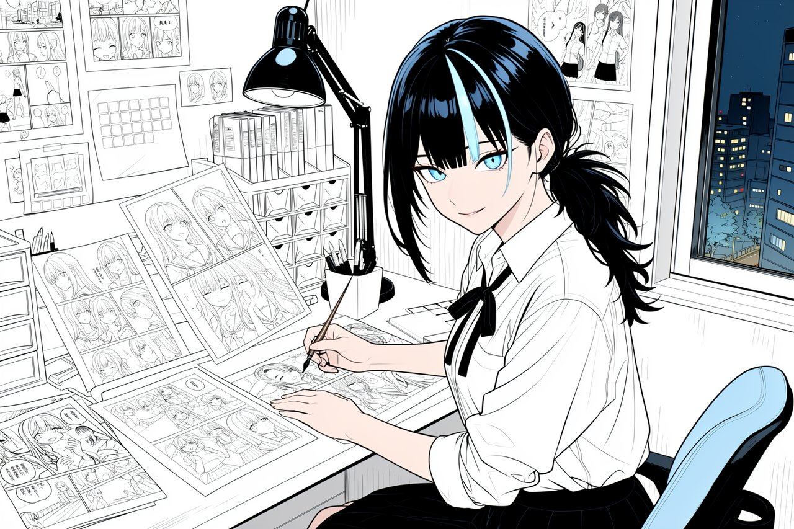

# Fumika

*Fumika, the app's mascot - a manga artist racing her next deadline. Artwork made with MOSS-Image and the app's own pipeline.*

A local studio for comics, images and LoRA training on your own PC (Windows or Linux, NVIDIA GPU; no macOS). Fumika brings its own image engine
(a bundled ComfyUI with its own Python, nothing else on the PC is touched), a persistent render queue, downloads, projects, a
reader and a local MCP server for AI agents. Everything model-specific comes as a **plugin** - you pick the ones you want at
first start and only their models are downloaded.

Bundled plugins:

| Plugin | What it does | Models |
|---|---|---|
| MOSS Doujin | a story becomes finished comic pages with speech bubbles; the cleanest of 3 versions is kept | MOSS-Image (Apache 2.0), optional WD eva02 tagger (Apache 2.0) |
| MOSS LoRA Trainer | train character / style LoRAs for MOSS-Image | MOSS-Image (Apache 2.0) |
| Slider Trainer | slider LoRAs (turn one thing up or down at -2 ... +2) for Anima (1.0, 2.9B, 3.8B), from two prompts or two image folders; SDXL sliders follow later | Anima |
| SDXL LoRA Trainer | LoRAs, LyCORIS and embeddings for SDXL / Illustrious / Pony checkpoints with kohya sd-scripts | your SDXL checkpoint |
| Anima LoRA Trainer | train LoRAs for Anima 1.0, 2.9B and 3.8B with kohya sd-scripts (3.8B LoRAs also work on 3.8B v1.1) | Anima (CircleStone Labs Non-Commercial) |
| Model families (MOSS-Image, Anima 1.0 / 2.9B / 3.8B, Anima 3.8B v1.1, SDXL / Illustrious) | the models, loaders and tested recipes of an architecture; workspaces use the ones that are switched on | MOSS-Image (Apache 2.0), Anima (CircleStone Labs Non-Commercial), Illustrious XL v2.0 / Animagine XL 4.0 (CreativeML OpenRAIL) |
| Image Studio | single pictures with MOSS-Image, Anima or SDXL: text to image, image to image, inpaint, upscaling (Real-ESRGAN, SeedVR2 or MOSS redraw), history with every setting | the switched-on model families, Real-ESRGAN (BSD-3), SeedVR2 (Apache 2.0) |
| Asset Studio | character assets in one image each: expression sets, outfits, turnarounds, profile sheets, item cards, chibi and pixel sprites; optional transparent VN sprites | MOSS-Image (Apache 2.0), BiRefNet (MIT) |

Languages: English, Deutsch, Français, Italiano, Español (España / Latinoamérica), Português (Brasil), 日本語, 한국어,
简体中文, 繁體中文 (machine-assisted translations - corrections welcome, see `src/lib/i18n/TRANSLATING.md`).

Every rendered picture carries its generation data: ComfyUI's graph (drop the PNG into ComfyUI to open it as a workflow) and
an A1111-style `parameters` text with prompt, settings and AutoV2 model / LoRA hashes, which A1111, Forge and Civitai read. It
is also marked as AI-generated (IPTC digital source type in XMP, EU AI Act Art. 50). Setup -> Export can leave the prompt data
out of exported pictures and CBZ files; the AI marking always stays.

Status: 0.1.1, in active development.

## Install

- **Windows**: `Fumika_<version>_x64-setup.exe` installs for the current user (no admin rights). The installer is not signed,
  so SmartScreen may warn: "More info" -> "Run anyway". The engine is the official ComfyUI Windows portable build.
- **Linux** (x86-64): `Fumika_<version>_amd64.AppImage` (make it executable and run it) or `Fumika_<version>_amd64.deb`. The
  engine is ComfyUI from source with its own Python 3.13 and PyTorch (CUDA 13), set up by [uv](https://github.com/astral-sh/uv)
  inside the install folder - the system Python is not touched. Needs the NVIDIA driver and `git` (the trainers clone their
  tools).

## License

- **Fumika** (everything in this repository outside `src-tauri/resources/plugins/*/nodes/`) is licensed under the
  [Apache License 2.0 with the Commons Clause](LICENSE): use it for anything, commercial work included, modify it and share
  it for free - you may not sell the software itself or a product or service whose value derives entirely or substantially
  from it. Because of the Commons Clause it is source-available, not OSI open source.
- **Your work is yours**: pages, comics, assets and LoRAs you make with Fumika are not covered by these licences (the models
  you use keep their own terms).
- **ComfyUI node packs** in `src-tauri/resources/plugins/*/nodes/` are licensed under the **GNU GPL v3.0** (see the LICENSE file in
  each pack), because they run inside ComfyUI (GPL-3.0).
  Exception: the bundled third-party pack `ComfyUI-MOSS-Image-Ostris-Edit` (MIT, Ostris, LLC) keeps its own MIT license.
- **Models** are not part of this repository. They are downloaded from their publishers and keep their own licenses; each plugin
  lists them and the app shows them before a download.
- **Name and artwork**: the name "Fumika", the logo and icons and the characters Fumika and Terra are not covered by the
  licenses above - all rights reserved. Forks must use their own name and artwork.

Copies and forks must keep the [NOTICE](NOTICE), the Commons Clause notice and the author credit in the app.
Contributing: [CONTRIBUTING.md](CONTRIBUTING.md). How authorship is documented:
[docs/PROVENANCE.md](docs/PROVENANCE.md).
